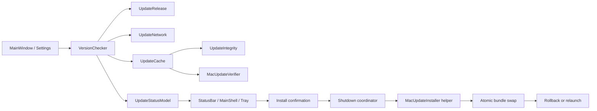
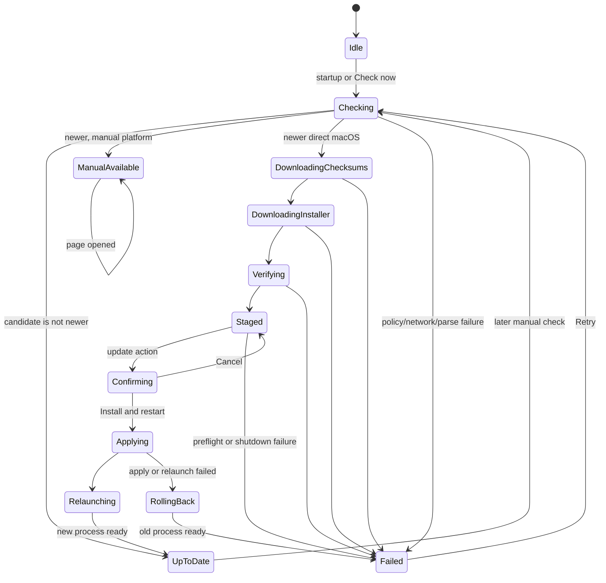

# Deskflow auto-updater design

- **Status:** implementation design only
- **Base:** `fork/master` at `bb309dfe9ceedab7af3523f2a49837e275b6e843` (`v2.0.5`)
- **Release source:** `subeom/deskflow` latest stable GitHub release
- **Primary platform:** directly installed, self-writable macOS app bundles
- **Non-goals enforced in this branch:** no updater implementation, no release work, no installed-app testing, no live replacement

## 1. Outcome

Deskflow replaces the current single-purpose version check with a bounded, testable update pipeline:

1. At startup, or on an explicit `Check now` action, query the latest stable GitHub release from the
   `subeom/deskflow` fork.
2. Select an exact plan for the current OS and CPU architecture. Never infer a different asset.
3. For a directly installed, eligible macOS app, download `SHA256SUMS.txt` and the exact DMG, verify both
   integrity sources, verify the mounted app's pinned code-signing identity, and atomically publish a staged
   update in the user cache.
4. Show the update through Deskflow's existing update surfaces. Downloading and staging never replace the
   running app.
5. After one explicit `Install and restart` confirmation, stop sharing, launch a detached macOS helper, replace
   the bundle transactionally, and relaunch.
6. On Homebrew or other package-managed macOS, Windows, and Linux, show the exact stable release page for a
   manual update. Do not execute an installer or package.

Any network, rate-limit, JSON, URL, asset, size, version, cache, path, digest, signature, shutdown, install,
rollback, or relaunch failure leaves the old release available and reported. It never falls back to another
repository, asset, architecture, checksum file, or installer source.

### 1.1 Scope

- Current update surfaces: `VersionChecker`, `StatusBar`, `MainWindow`, the redesigned `MainShell` rail, and
  the tray menu.
- Existing `Settings` preference for checks at startup.
- GitHub release discovery, release planning, bounded network access, ETag handling, cache staging, integrity
  verification, macOS platform verification, detached installation, coordinated shutdown, rollback, relaunch,
  and recovery reporting.
- macOS self-install for direct installs that Deskflow can update without Homebrew/package-manager ownership
  and without obtaining elevated privileges.
- Manual release-page flows for package-managed macOS, Windows x64 and ARM64, and Linux.
- Korean-ready source strings and translation entries. All user-facing state must be localizable.

### 1.2 Non-goals

- No unattended replacement and no persisted "always install updates" preference.
- No Windows installer execution, MSI signing, Windows service update, or privilege-elevation design.
- No Linux AppImage, Flatpak, DEB, RPM, PKGBUILD, or package-manager execution.
- No Homebrew command execution and no replacement of Homebrew-owned files.
- No Developer ID, Apple notarization, `spctl`, Team Identifier, or upstream `deskflow/deskflow` trust model.
- No fallback to a prerelease, draft, `continuous` tag, upstream repository, universal asset, portable archive,
  ARM64 asset on x64, or x64 asset on ARM64.
- No telemetry, analytics, crash-upload endpoint, authenticated GitHub token, keychain access, or user/device
  identification.
- No hidden update endpoint override, arbitrary URL setting, shell command, or archive extraction outside the
  controlled DMG path.
- No other operating system is added by an implicit default.

## 2. Alternatives considered

### Alternative 1: keep a URL-only checker

Retain `VersionChecker` as a plain-text check and open the general download page when a new version exists.
This has the smallest implementation cost and works on all OSes, but it gives no verified stage, no exact asset
selection, no restart handoff, and no protection against a malicious or stale release URL. It is rejected
because it does not satisfy automatic verification and macOS installation.

### Alternative 2: cross-platform package execution

Download and execute each platform's package: DMG on macOS, MSI on Windows, and DEB/RPM/AppImage/Flatpak on
Linux. This offers one visible flow, but Windows MSIs are unsigned, Linux package ownership varies, and package
execution would introduce privilege, service, signing, distro, and rollback contracts that do not exist. It is
rejected as unsafe and speculative.

### Alternative 3: testable staged updater with macOS-only self-install (selected)

Separate release parsing, asset planning, network access, integrity checks, cache staging, platform
verification, transaction application, UI presentation, and process shutdown. Use the pipeline on direct
macOS installs and expose exact release pages elsewhere. This retains the useful boundaries from
`fork/wip/auto-updater`, fits the current Settings and redesigned UI, and permits deterministic failure
injection without pretending that every OS has the same trust model. It is selected.

## 3. Architecture and component boundaries



### 3.1 Release discovery and asset planning

`UpdateRelease.cpp`/`.h` remains pure and has no networking, disk, UI, or platform commands.

It exposes:

- `parseGitHubRelease(QByteArray) -> UpdateReleaseParseResult`
- `planUpdate(UpdateRelease, UpdateEnvironment) -> optional<UpdatePlan>`
- `parseSemanticVersion(QString) -> optional<UpdateVersion>`
- `isNewerUpdateVersion(current, candidate) -> bool`
- `parseChecksumManifest(QByteArray, expectedName) -> UpdateChecksumResult`

The parse result carries a bounded error category and a sanitized `UpdateRelease`. It contains only:

```text
UpdateRelease {
  schemaVersion: 1
  tag: "v2.0.5"
  version: "2.0.5"
  pageUrl: exact GitHub tag URL
  assets: name, browserDownloadUrl, size, sha256Digest
}
```

Release JSON fields not needed by the updater, including release body, author, timestamps, uploader details,
and unrelated links, are never retained. `UpdatePlan` contains:

- normalized `platform` and `architecture`;
- install mode: `automatic-macos`, `manual`, or `unsupported`;
- exact release page URL;
- optional exact installer asset;
- optional exact `SHA256SUMS.txt` asset;
- bounded expected size and SHA-256 digest for every retained asset.

`UpdateEnvironment` is made once at startup from Qt platform/CPU APIs and install ownership detection. Unknown
or mixed architecture strings do not map to a preferred architecture. `x86_64` and `amd64` normalize to the
Windows/macOS package token `x64` or `x86_64` as required by CPack; `arm64` and `aarch64` normalize to `arm64`.
Any other CPU value produces `unsupported`.

### 3.2 Bounded network

`IUpdateNetwork` is the existing test seam from the old branch. `QtUpdateNetwork` implements it with
`QNetworkAccessManager`. It owns request IDs, redirects, cancellation, timeout enforcement, response-byte
limits, rate-limit classification, and ETag headers. It never makes policy decisions about versions or asset
selection.

The network result is:

```text
UpdateNetworkResult {
  status: Success | NotModified | Cancelled | Timeout | TooLarge |
          RateLimited | NetworkError | HttpError | PolicyError
  httpStatus
  data
  finalUrl
  sanitizedError
  etag
  retryAfter
}
```

No callback may run after cancellation, because `VersionChecker` increments a generation token before
discarding request state. The network layer stores at most one active update request.

### 3.3 Integrity and staging cache

`UpdateIntegrity` verifies size and SHA-256 independently of platform signing. It is used for the release
asset, `SHA256SUMS.txt`, and all staged files.

`UpdateCache` owns:

```text
<QStandardPaths::CacheLocation>/updates/
  state.json
  stages/<version>/<asset-name>
  stages/<version>/SHA256SUMS.txt
  stages/<version>/manifest.json
  transactions/<id>.json
  .incoming-<id>/
```

The cache exposes `find(plan)`, `stage(plan, payloads)`, `load(manifestPath)`, `discard(staged)`, and
`cleanup()`. It owns all filesystem policy described in Section 5.5. It does not mount DMGs, verify code
signatures, or install.

`StagedUpdate` contains only canonical cache paths and the already-validated version, asset name, manifest
path, and installer path. A cache hit is re-read and reverified; existence alone never makes it usable.

### 3.4 Platform verifier

`IUpdateVerifier` is implemented by `MacUpdateVerifier` on macOS. `createPlatformUpdateVerifier()` returns no
verifier elsewhere. Manual platforms do not download and therefore never call it.

The verifier:

1. requires a regular, non-symlink `.dmg`;
2. mounts it read-only at an isolated temporary mount point with `/usr/bin/hdiutil`;
3. requires exactly one root `Deskflow.app` that is not a symlink and is within the mount point;
4. copies it with system tools into an isolated temporary test directory;
5. verifies `Info.plist` bundle ID and version;
6. verifies the pinned macOS signature;
7. always detaches the image on success or failure and removes its temporary copy.

Command execution is injected through `IUpdateCommandRunner`, which makes timeout, malformed output, mount,
copy, detach, and command failure deterministic in tests.

### 3.5 Orchestration

The existing `VersionChecker` class becomes the update workflow coordinator rather than a text parser. It
holds one generation, one release plan, one network request, one cache, and one verifier. It accepts injected
dependencies in tests.

Its signals are deliberately coarse:

```text
stateChanged(UpdateStatusSnapshot)
manualUpdateAvailable(UpdateManual)
stagedUpdateAvailable(StagedUpdate)
checkCompleted()
```

It does not open browsers, display dialogs, stop the core, or launch a helper.

### 3.6 UI state

`UpdateStatusModel` is a small QObject that owns the single presentation snapshot consumed by:

- the legacy `StatusBar`;
- the redesigned `MainShell` bottom-rail update action;
- the existing tray update badge and row.

The model stores state, target version, exact release page, sanitized user error, and an action kind. It stores
no raw JSON, response body, URL query, stack trace, digest, or filesystem path. A user action is a single
`UpdateAction` value: `open-release`, `confirm-install`, `retry`, or `none`.

`MainWindow` owns the update model, checker, installer, and shutdown coordinator wiring. `StatusBar` is only a
renderer/adapter and no longer owns independently inferred staged or error flags.

### 3.7 Installer and transaction helper

`IUpdateInstaller` and the production `MacUpdateInstaller` own eligibility and transaction execution. They do
not discover releases or decide which asset to use.

The parent process calls:

```text
preflight(StagedUpdate) -> UpdateInstallResult
start(StagedUpdate, explicitConfirmation=true) -> UpdateInstallResult
```

After preflight, `start` launches the same signed app executable in standby helper mode with validated
arguments:

```text
--apply-update=<canonical-manifest-path>
--update-parent-pid=<current-pid>
--update-receipt=<canonical-receipt-path>
```

The helper branches before shared-memory acquisition, `MainWindow`, accessibility prompting, tray creation,
core startup, and network checking. It uses the platform installer implementation and a fixed command parser.
It performs no bundle mutation until the parent writes `shutdown-complete`. It accepts no general command line
or shell fragment.

`applyPlatformUpdate()` remains the helper entry point from `deskflow-gui.cpp`; it is not a normal GUI startup
path.

### 3.8 Shutdown coordination

`MainWindow` gains an update-specific asynchronous shutdown method; normal close behavior is unchanged. It:

1. blocks a second update action and cancels outstanding checks/downloads;
2. calls a `CoreProcess` update-shutdown method that moves a desktop core from `Started`, `Starting`, or
   `RetryPending` to `Stopped` and emits completion;
3. waits for `TunnelController::shutdown()` completion;
4. saves settings and flushes log state;
5. only then releases normal shutdown to `QApplication`.

The coordinator has a 15-second core timeout and a 10-second tunnel timeout. It does not force-install on
timeout. If shutdown does not reach the required state, it cancels the transaction, restores the pre-apply
sharing state when necessary, and leaves the current GUI running with a failed-update message. macOS
self-install is eligible only in `ProcessMode::Desktop`; a service process, an unknown process owner, or a
daemon that cannot be acknowledged is a manual-update case.

## 4. Exact data flow and state machine

### 4.1 States

The state machine is owned by `VersionChecker` and mirrored, for presentation only, by `UpdateStatusModel`.



`ManualAvailable` remains available in memory after opening the page; opening the browser is not treated as
completion of an installation.

`RollingBack` is an internal helper state persisted in the transaction receipt and may be shown only after the
old app is relaunched. The helper never reports `UpToDate` by itself. The relaunched process re-derives the
current version from its own binary and either reports:

- `up-to-date` for a successful new version; or
- `update failed; previous version restored` before entering `Failed`.

### 4.2 Startup and manual check

1. `MainWindow::open()` preserves the existing one-time choice for startup update checks. The prompt says that
   updates are checked from `subeom/deskflow` on GitHub and no longer prints a configurable URL.
2. If the saved `gui/enableUpdateCheck` value is false, automatic checking stops. The Settings `Check now`
   button is still usable.
3. If checking is enabled, or the user chose `Check now`, `VersionChecker::checkLatest(reason)` transitions to
   `Checking`. Startup never blocks window display or core start.
4. The checker sends a conditional GET to the pinned latest-release endpoint. It uses a stored ETag only for
   this exact endpoint.
5. A `304 Not Modified` path loads and revalidates the previously sanitized release plan snapshot. A missing,
   invalid, oversized, or version-mismatched snapshot is a failed check, not `UpToDate`.
6. A `200` response is size-bounded and parsed. Drafts and prereleases are rejected even if the endpoint or a
   fixture returns one.
7. The release tag must be a stable three-component version. `candidate <= current` transitions to
   `UpToDate` and causes stale staged data to be cleaned. The current app never downgrades.

### 4.3 Manual platform result

For Homebrew/package-managed macOS, Windows, and Linux:

1. The plan is created with an exact fork release URL.
2. On Windows, matching x64 or ARM64 MSI metadata may be retained as descriptive release information if it is
   present. Missing metadata does not hide a newer version, and no MSI is downloaded or selected for
   execution.
3. macOS package-managed and Linux plans contain no installer payload.
4. The result is `ManualAvailable`.
5. The existing update action opens the exact validated `releaseUrl` only after a user click. The app does not
   open the browser from a background check.
6. No MSI, package, archive, or DMG is staged or executed.

### 4.4 Automatic macOS staging

For eligible direct macOS installs only:

1. Select exactly one DMG:
   - ARM64: `deskflow-<version>-macos-arm64.dmg`
   - x86-64: `deskflow-<version>-macos-x86_64.dmg`
2. Select exactly one case-sensitive `SHA256SUMS.txt`.
3. Require valid `sha256:` API digests and positive sizes for both assets.
4. Search for a matching staged version in the cache. A cache hit runs integrity and platform verification
   again before it can transition to `Staged`.
5. If there is no valid stage, download `SHA256SUMS.txt`, verify its size and GitHub digest, and safely parse
   one exact line for the selected DMG.
6. Download the DMG. Require its byte count and SHA-256 to match all three values: GitHub asset digest,
   GitHub asset size, and the parsed checksum line.
7. Atomically write the `.incoming` directory, verify all files from disk, write the manifest, rename it to the
   version stage, and re-load it. A partial stage is never published.
8. Run `MacUpdateVerifier`; on any failure discard the stage and enter `Failed`.
9. Enter `Staged` and display the target version. The running bundle is untouched.

### 4.5 Confirmation and parent shutdown

1. Clicking the staged update action opens a native modal with Cancel as the default.
2. The dialog states the current and target version, that the DMG and stable signature have been verified, and
   that Deskflow will stop sharing and restart.
3. Only the button labeled `Install and restart` enters `Confirming -> Applying`.
4. `MacUpdateInstaller::preflight` re-loads the manifest, verifies the stage, verifies destination ownership
   and writability, confirms direct install ownership, checks free space, and writes an initial transaction
   receipt. A failure returns to `Failed` while the GUI and core remain running.
5. The detached helper is launched in standby. Helper launch is not considered ready until the helper writes a
   matching `helper-ready` receipt within five seconds. The receipt binds the helper PID, a random transaction
   token, and the parent process start identity; a PID alone is insufficient.
6. The parent stops the core and Cloudflare Tunnel in the Section 3.8 order and saves settings.
7. The parent writes `shutdown-complete` and exits. Only this receipt permits the helper to mutate the bundle.
   The helper waits for the exact parent PID and captured process start identity to disappear.
8. Any pre-exit failure terminates the standby helper, restores the prior `deskflow-core` and tunnel state when
   necessary, keeps the old GUI open, marks the transaction as failed, and performs no bundle operation.

### 4.6 Apply transaction

1. The helper validates command-line arguments, parent PID/start identity, helper receipt, and canonical
   manifest path. It refuses a PID `<= 1`, its own PID, a reused PID/start-time mismatch, an out-of-cache
   manifest, or a path containing a symlink.
2. The helper revalidates the stage and re-verifies the DMG signature and version. Verification failure restores
   or relaunches the old app without changing the live bundle.
3. The helper mounts the DMG read-only under a temporary directory and copies exactly `Deskflow.app` to a unique
   sibling candidate in the live bundle's parent directory.
4. The candidate is verified before quarantine is removed. Because the release is self-signed, the helper
   removes only `com.apple.quarantine` from the verified candidate and verifies that the attribute is absent.
   It never clears user-wide quarantine state or calls `security`.
5. The helper checks that the candidate is on the same volume, the candidate is unique, and free space is
   sufficient.
6. It renames the live old bundle to a unique backup and then renames the candidate to the live path. Both
   names are siblings under one validated parent. This is the only replacement commit point.
7. The helper launches the candidate executable by absolute path with
   `--update-receipt=<receipt-path>` and `--update-handshake=<random-path>`. The normal app writes a mode-0600
   record containing `ready`, its PID, and the random token atomically after MainWindow initialization. The
   helper waits at most 30 seconds and requires the token and spawned PID to agree.
8. On readiness, the helper writes `success`, removes the backup and consumed stage, and exits.
9. On copy, verification, mount, detach, rename, launch, handshake, or readiness failure before the final
   success, the helper performs the inverse operations. It stops only the candidate PID it launched, renames
   any live candidate aside, restores the old backup to the live path, and relaunches the old absolute
   executable with the receipt path.
10. The old relaunch is awaited using the same 30-second readiness handshake. Only a successful old handshake
    makes the transaction `rolled-back`. The backup is retained if any rename or relaunch recovery operation
    fails, and the helper presents a blocking local error with the exact recovery action. It never silently
    reports success or retries the new bundle.

The helper never deletes the last recoverable old bundle until the replacement app has announced readiness.

## 5. Trust, integrity, and security policy

### 5.1 Two independent trust questions

The update pipeline answers two separate questions:

1. **Did GitHub deliver the expected release bytes?** The GitHub asset metadata, byte size, SHA-256 digest,
   and `SHA256SUMS.txt` answer this integrity question.
2. **Does the app belong to this fork's signing identity?** The pinned macOS bundle identifier and certificate
   leaf hash answer this authenticity question.

GitHub-hosted hashes are not the trust root. A compromised account, release API, CI upload, repository, or
GitHub compromise could alter the DMG and publish matching digest and checksum values. Only the externally
compiled signing requirement binds the candidate to the fork's existing macOS identity:

```text
identifier "org.deskflow.deskflow" and certificate leaf = H"39b1c21df0ba75cdde058fcbb09a1ad38aef8055"
```

The certificate is self-signed and is not Apple-notarized. `spctl` is intentionally not used. Failure from
`spctl` would be expected and has no policy meaning. The updater does not call `security`, import trust, or
open the real keychain.

### 5.2 Release URL policy

The metadata URL is compiled:

```text
https://api.github.com/repos/subeom/deskflow/releases/latest
```

`Settings::Gui::UpdateCheckUrl` is retired as an input. A persisted value from an older build is ignored, and
the startup prompt no longer displays it. The updater does not accept configuration, environment variables,
command-line flags, release bodies, or JSON fields that replace this endpoint.

Allowed URL forms:

| Purpose | Allowed form |
| --- | --- |
| Release metadata | exact `https://api.github.com/repos/subeom/deskflow/releases/latest` |
| Release page | exact `https://github.com/subeom/deskflow/releases/tag/<stable-tag>` |
| Direct asset URL | exact `https://github.com/subeom/deskflow/releases/download/<stable-tag>/<safe-asset-name>` |
| Terminal asset redirect | exact hosts `release-assets.githubusercontent.com`, `objects.githubusercontent.com`, or `github-releases.githubusercontent.com` |

All URLs:

- use HTTPS;
- have no user info, IP-literal host, fragment, or non-443 explicit port;
- are at most 8 KiB after normalization;
- compare host names case-insensitively and paths byte-for-byte after Qt normalization;
- have no encoded slash, backslash, dot segment, control character, or NUL in a policy-bearing component.

The metadata request permits no redirect. A direct asset request permits at most three redirects. After the
first redirect from the exact `github.com` asset URL, only the three terminal asset hosts are allowed. No
terminal host may redirect again. A signed CDN query is permitted only on a terminal asset response and is
never logged or persisted in full.

### 5.3 Release JSON validation

The parser enforces:

- response is one JSON object and no more than 2 MiB;
- `draft == false` and `prerelease == false`;
- `tag_name` matches `^v(0|[1-9][0-9]*)\.(0|[1-9][0-9]*)\.(0|[1-9][0-9]*)$`;
- version components fit `quint64`;
- `html_url` exactly matches the tag page for `subeom/deskflow`;
- `assets` contains 1 through 128 objects;
- every asset name is 1 through 200 ASCII bytes and matches
  `^[A-Za-z0-9][A-Za-z0-9._+-]*$`;
- names are unique and case-sensitive;
- `browser_download_url` exactly matches the release, tag, and asset name;
- `size` is a positive 64-bit integer below the per-asset limit;
- `digest` matches `^sha256:[0-9a-fA-F]{64}$`.

For automatic macOS, missing either the exact architecture DMG or `SHA256SUMS.txt` is a failed plan. A
`sums.txt`, differently cased name, extra universal asset, or upstream `deskflow/deskflow` URL is not a
fallback.

### 5.4 `SHA256SUMS.txt` parser

`SHA256SUMS.txt` itself must pass its GitHub size/digest checks before its contents are considered.
The parser:

- accepts at most 2 MiB, 256 lines, and 1 KiB per line;
- accepts LF or CRLF line endings, rejects lone CR and NUL bytes, and permits one final valid line without a
  terminating LF;
- accepts the exact GNU `sha256sum` shape:
  `64-hex-digits + two ASCII spaces + safe-asset-name`;
- permits `64-hex-digits + two ASCII spaces + "*" + safe-asset-name` for GNU binary format, but never
  permits leading whitespace, a single separator, an absolute path, `./`, `../`, slash, backslash, colon, or
  control character;
- rejects duplicate names, duplicate selected lines, conflicting hashes, comments, blank interior lines, and
  malformed unrelated lines rather than ignoring them.

There must be exactly one entry for the selected DMG. Its hash is compared case-insensitively with the
lower-case SHA-256 computed from the bytes and with the GitHub asset digest after removing `sha256:`. The
file may list other safe release assets, but all lines still have to parse. No path is derived from checksum
text.

### 5.5 Cache, manifest, and path policy

The cache root comes only from `QStandardPaths::CacheLocation`. The resolved root must be owned by the
current user, must not be a symlink, and must not be group/world writable. A directory or file that fails this
check is not repaired in place.

Rules:

- no cache file or directory in the resolved path may be a symbolic link;
- on POSIX, staged regular files must have link count 1;
- `manifest.json`, the DMG, and `SHA256SUMS.txt` must be regular files inside the canonical version stage;
- no manifest field supplies `..`, slash, backslash, an absolute path, drive prefix, or a name outside the
  stage;
- writes use a private `.incoming-<uuid>` directory with mode 0700, files mode 0600, `QSaveFile`, close-time
  error checks, and one final directory rename;
- no consumer follows a cache path until canonicalization is repeated after opening;
- `discard` accepts only an already-loaded `StagedUpdate` and removes only a validated stage child;
- the installer never accepts an arbitrary `manifestPath` supplied by a user, browser, or drag-and-drop.

Manifest version 1 fields are:

```text
schemaVersion
stageId
repository = "subeom/deskflow"
version
tag
releaseUrl
installerName
installerDigest
installerSize
checksumName = "SHA256SUMS.txt"
checksumDigest
checksumSize
selectedChecksum
createdAtUtc
```

On load, every field is required and type-checked. Paths are reconstructed from cache policy rather than
trusted from JSON. Both payloads are rehashed and size-checked. The selected checksum is checked again.

Cleanup runs only at app startup and after a completed transaction. It removes:

- incomplete `.incoming` directories;
- corrupt stages;
- stages older than 30 days;
- versions no longer newer than the running version;
- all but the newest valid stage when total staged bytes would exceed 768 MiB.

Cleanup failures are visible and disable cache use for that check. The version check may still report a valid
release as manual, but it cannot claim an automatic stage is ready.

### 5.6 macOS signature verification

The verifier uses this exact root requirement through an injected system-command runner:

```text
/usr/bin/codesign --verify --deep --strict \
  --test-requirement='=identifier "org.deskflow.deskflow" and certificate leaf = H"39b1c21df0ba75cdde058fcbb09a1ad38aef8055"' \
  Deskflow.app
```

It additionally:

- requires `CFBundleIdentifier` to be `org.deskflow.deskflow`;
- requires both `CFBundleShortVersionString` and `CFBundleVersion` to equal the selected stable version;
- verifies the `Deskflow` and `deskflow-core` executables as strict nested code objects with the pinned leaf
  certificate;
- rejects ad hoc signing, upstream Apple Developer ID signing, notarization-only evidence, a wrong bundle ID,
  a wrong leaf, or missing nested executable signatures;
- bounds command output to 64 KiB and UI diagnostic text to 240 characters;
- never requires a Team Identifier, hardened runtime, notarization, or `spctl` success.

This policy deliberately matches the stable signing policy documented in
`docs/dev/mac-stable-signing.md`. Certificate-key rotation is a code change to this pin and a new release
process, never an automatic network trust update.

### 5.7 Network policy, ETag, and rate limiting

Limits:

| Data | Limit |
| --- | --- |
| Release JSON | 2 MiB |
| Asset count | 128 |
| `SHA256SUMS.txt` | 2 MiB |
| macOS DMG | 512 MiB |
| URL after normalization | 8 KiB |
| Connect/read timeout | 30 seconds |
| DMG total request time | 5 minutes |
| Total metadata/checksum/DMG redirects | 3 per asset request |
| Automatic network retries | 1 for metadata/checksum transient transport, timeout, HTTP 408, or 5xx; never for rate limits |

The ETag belongs only to the latest-release endpoint. It and a sanitized, bounded release snapshot are stored
in `state.json` with the fixed endpoint, snapshot schema version, ETag, snapshot version, rate-limit retry
time, and last successful check time. A binary or checksum GET is never conditional.

`304` uses the stored snapshot only after its complete parser and version-plan validation succeeds. On a `304`
with a bad snapshot, the check fails and tells the user to retry; it does not silently claim no update.

`403` with `X-RateLimit-Remaining: 0` and `429` are `RateLimited`. `Retry-After` and
`X-RateLimit-Reset` are parsed, bounded to 24 hours, persisted locally, and shown as a user time. No immediate
automatic retry runs. A retry button remains unavailable until that local time. ETag state and a previously
valid stage are retained.

Timeouts, DNS/TLS failure, connection loss, and 5xx receive at most one fresh full request for metadata or
checksums after a two-second delay. The retry uses the same URL and headers. DMG transfers are not resumed and
are not retried automatically because one automatic stage can otherwise consume more than the disk and network
budget. A user `Retry` starts a fresh high-level check and discards only partial data.

## 6. Platform behavior matrix

| Platform/install | Architecture/asset | Discovery | Download and stage | Install after confirmation | Result action |
| --- | --- | --- | --- | --- | --- |
| Direct macOS app, user-writable, no package owner | ARM64 DMG or x86-64 DMG, exact match only | latest stable fork release | `SHA256SUMS.txt` + DMG, full verification | detached helper and atomic bundle swap | `Install and restart` |
| Homebrew macOS app, app symlink, `Caskroom`, `Cellar`, MacPorts, or uncertainty in ownership | no installer payload | same | no download | no | exact fork release page plus package-manager instructions |
| Windows installed or portable, x64 or ARM64 | no installer payload; matching MSI metadata is descriptive only | same | no download | no | exact fork release page |
| Linux package-managed install | release-page plan only | same | no download | no | exact fork release page and package-manager instruction |
| Linux portable/unknown package type | no inferred asset | same | no download | no | exact fork release page |
| FreeBSD or any other OS | unsupported | disabled | none | none | no update action; no speculative endpoint use |

Package ownership fails safe. A macOS app is eligible only when:

- the executable maps to `Deskflow.app/Contents/MacOS/Deskflow`;
- the lexical and canonical bundle path agree and the bundle is not a symlink;
- the bundle is not under `/Volumes`;
- no app-path component or receipt indicates Homebrew `Caskroom`/`Cellar`, MacPorts, or another package owner;
- the bundle and parent directory are directly writable without elevation;
- the DMG's architecture exactly matches `QSysInfo::currentCpuArchitecture()`.

If any check is unknown, the plan is manual rather than self-installing. Global package-manager metadata may
cause a conservative manual classification; it never causes a direct install to be overwritten.

Windows self-install is a future phase with a signing and MSI trust policy. The current updater does not infer
Authenticode trust, invoke `msiexec`, stop the Windows service, or run an unsigned MSI.

## 7. UI, settings, and localization

### 7.1 Existing surfaces only

One `UpdateStatusModel` snapshot drives all existing surfaces:

- **System-look window:** the current `StatusBar` update button.
- **Deskflow-look window:** the existing bottom `MainShell` rail action identified by `update`. No new card,
  hero, banner, modal-on-startup, or page is added.
- **Tray:** the existing update badge and fact row in `TrayMenuModel`.
- **Settings:** the existing `Updates and power` card in the General page. Keep the startup switch and add one
  in-row `Check now` button.

The source model is the only place that decides `Hidden`, `Checking`, `Manual`, `Staged`, `Failed`, or
`Installing`. The legacy bar, shell, and tray only format that shared state. This prevents the old branch's
StatusBar-specific state from drifting from the redesigned shell and tray.

Background discovery does not steal focus, open the browser, or show an OS notification. A failure is visible
in the existing update action and logs. Clicking the failure action opens one modal with a bounded message and
`Retry`.

### 7.2 Settings behavior

The existing `gui/enableUpdateCheck` setting remains:

- unset: ask once on first eligible startup using `messages::showUpdateCheckOption`;
- true: check once on each app startup and on manual request;
- false: no automatic network request, but `Check now` remains available.

`UpdateCheckUrl` is no longer a valid updater input. The UI does not expose a source URL. The pinned repository
name is shown as explanatory text.

There is no setting for automatic installation, update channel, architecture, certificate pin, network host,
or package fallback. A confirmation is required for each staged transaction and cannot be remembered.

### 7.3 User actions

| State | Existing action label | Action |
| --- | --- | --- |
| Up-to-date | none | no persistent action |
| Manual | `View update` | open exact release page |
| Staged | `Install update` | show confirmation |
| Failed | `Update check failed` / `Update failed` | show bounded failure and `Retry` |
| Checking | `Checking for updates` (disabled) | none |
| Applying | `Installing update` (disabled) | none |

The staged action is only available when both integrity verification and platform verification succeeded for
the current plan. A release version alone never enables `Install and restart`.

### 7.4 Korean-ready source strings

All strings use `tr()` or the existing `QT_TRANSLATE_NOOP` helpers and avoid constructing a sentence from
prelocalized fragments. New strings and Korean translations are:

| English source | Korean |
| --- | --- |
| `Check for updates on startup` | `시작할 때 업데이트 확인` |
| `Check now` | `지금 업데이트 확인` |
| `Checking for updates...` | `업데이트 확인 중...` |
| `Deskflow is up to date` | `최신 버전의 Deskflow 사용 중` |
| `Update available` | `업데이트 사용 가능` |
| `View update` | `업데이트 보기` |
| `Update v%1 is verified and ready to install` | `업데이트 v%1 확인 및 설치 준비 완료` |
| `Install update` | `업데이트 설치` |
| `Install Deskflow v%1?` | `Deskflow v%1을(를) 설치할까요?` |
| `Deskflow will stop sharing, replace the app, and restart.` | `공유를 중지하고 앱을 교체한 후 다시 시작합니다.` |
| `Install and restart` | `설치 후 다시 시작` |
| `Cancel` | `취소` |
| `Updating Deskflow...` | `Deskflow 업데이트 중...` |
| `Update failed` | `업데이트 실패` |
| `The previous Deskflow version was restored.` | `이전 Deskflow 버전이 복원되었습니다.` |
| `This installation is managed by a package manager. Update it from the release page or package manager.` | `패키지 관리자에서 관리하는 설치입니다. 릴리스 페이지 또는 패키지 관리자에서 업데이트하세요.` |

No Korean sentence uses an em dash. Product and role names remain in English. Translation tests ensure the
source keys exist in `deskflow_ko.ts` and that no UI state bypasses translation.

## 8. Error handling, retry behavior, privacy, and resource limits

### 8.1 Stable error categories

The internal code uses stable categories; the UI uses localizable text and never exposes the raw network or
system error as the only explanation.

| Category | Automatic behavior | UI/log behavior |
| --- | --- | --- |
| `RateLimited` | stop; wait until persisted retry time | show retry time, retain valid stage |
| `NetworkTransient` | one metadata/checksum retry; no DMG auto-retry | show `Retry`; log endpoint category only |
| `ResponseTooLarge` | abort and release bytes | show `Retry`; log limit and class |
| `InvalidReleaseJson` | abort; no alternate endpoint | show update check failed |
| `UnsupportedPlan` | manual or unsupported by platform policy | manual release page, or no update action |
| `AssetMissing` | abort exact plan; no alternate asset | show release asset unavailable |
| `DigestOrSizeMismatch` | delete incoming/stale stage; no use | show update verification failed |
| `ChecksumInvalid` | discard partial stage | show update verification failed |
| `CacheUnsafe` | disable cache for this check | show cache failure; valid manual page remains |
| `SignatureRejected` | discard stage and preserve old app | show security verification failed |
| `InstallPreflightFailed` | do not launch helper; old GUI/core continue | show exact safe reason |
| `ShutdownFailed` | cancel apply and resume prior sharing state | show update not installed |
| `InstallFailed` | transactional rollback and old relaunch | show previous version restored |
| `RelaunchFailed` | rollback to old, relaunch old, retain backup | show update not installed |

Logs include state transitions, target version, expected architecture, asset name, byte count, error category,
and bounded system stderr. They never log release bodies, tokenized redirect query strings, full request
headers, full manifest paths outside a bounded safe suffix, personal configuration, machine host names, or
private settings.

### 8.2 Failure invariants

- No failure installs or executes an alternate artifact; rollback launches only the verified old bundle at the
  original live path.
- No partially written stage is visible.
- No `Failed` state advertises an installable version.
- A failed platform verification deletes the stage or marks it unusable.
- A preflight or shutdown failure happens before the commit point and leaves the current GUI and sharing state
  running.
- A post-commit failure restores the old bundle and relaunches the old executable before `rolled-back` is
  reported.
- A failed install never changes the startup update preference or package-manager ownership classification.
- A manual `Retry` repeats the same trust policy. It never falls back to a weaker source.

### 8.3 Privacy

The updater:

- sends `User-Agent: Deskflow/<version>` plus the required GitHub accept/version headers;
- does not send OS pretty-product text, locale, language, hostname, local IP, layout, computer list, account,
  installation ID, or TLS fingerprint;
- uses no telemetry, analytics, timing beacon, or background usage upload;
- stores only sanitized stable release fields, one ETag, retry time, staged hashes, and transaction state;
- exposes an exact release page in the browser only on user action;
- never creates an authenticated GitHub client and never reads the user's keychain.

GitHub necessarily observes the client IP through HTTPS, as it does for a normal release-page request. No
Deskflow service or third-party update analytics is involved.

### 8.4 Disk and process safety

- At most one macOS DMG and one current stage may be published.
- The stage root quota is 768 MiB plus at most one 512 MiB `.incoming` payload.
- Apply preflight requires free space of at least `2 * declared DMG size + 128 MiB` on the bundle volume.
- Every mount and command has an absolute program path and argument list; no shell invocation is used.
- The verifier detaches any mounted volume on every exit path.
- The helper opens no UI in the replaced bundle's normal startup path. Only a blocking recovery dialog is
  allowed if the old bundle cannot be relaunched.
- There is one active transaction lock. A concurrent helper or stale parent PID is not ignored; the transaction
  becomes failed and is surfaced.

## 9. Testing strategy

Production tests must not touch `/Applications`, `~/Library/Deskflow`, the real keychain, the desktop, the
running GUI/core/cloudflared processes, or port 24800.

### 9.1 Pure release and planning tests

`UpdateReleaseTests` covers:

- v2.0.5 latest stable parsing;
- draft and prerelease rejection;
- tag, page URL, repository, and asset URL spoofing;
- wrong JSON types, trailing/oversized fields, duplicate assets, case collisions, invalid names, and missing
  `digest`;
- exact DMG architecture selection and Windows x64/ARM64 manual plans;
- Homebrew and Linux manual plans;
- current/newer/older version ordering with no downgrade;
- missing x64 DMG on an x64 host fails without using ARM64 or universal;
- `SHA256SUMS.txt` requirement and explicit rejection of `sums.txt`.

### 9.2 Pure network policy tests

`UpdateNetwork` policy functions cover:

- exact HTTPS host/path acceptance;
- HTTP, user info, ports, fragments, path traversal, encoded separators, and oversized URL rejection;
- API redirect rejection;
- CDN host redirects only for the selected asset request;
- redirect-count limits;
- ETag, 304, `429`, `403` with exhausted rate limit, invalid `Retry-After`, timeout, byte overflow, and
  cancellation;
- no response-body logging and no signed CDN query retention.

`VersionCheckerTests` injects `IUpdateNetwork` and proves state transitions, stale-callback rejection after
cancel, ETag use, rate-limit scheduling, no asset selection fallback, manual platform behavior, staged reuse,
and every failure category.

### 9.3 Integrity and checksum mutation tests

`UpdateIntegrityTests` mutates:

- one installer byte;
- declared size;
- GitHub digest;
- selected checksum;
- checksum line separator;
- duplicate, conflicting, missing, path-like, NUL, overlong, and malformed filenames;
- the digest of `SHA256SUMS.txt` itself.

Every mutation must fail before cache publication.

### 9.4 Cache and path tests

`UpdateCacheTests` uses only a temporary directory and tests:

- exact stage/manifest publication;
- rehash on every cache load;
- tampered manifest, payload, checksum, version, release URL, and path;
- symlinked root, stage, manifest, DMG, and checksum;
- hardlink rejection on POSIX;
- wrong mode, invalid JSON, wrong schema, duplicate load, interrupted `.incoming`, disk-full simulation,
  stale cleanup, quota cleanup, and refusal to discard outside the root.

### 9.5 Platform verifier tests

`MacUpdateVerifierTests` splits into:

- fixture parsing for the pinned bundle/certificate requirement;
- rejection of ad hoc, wrong bundle ID, wrong leaf, upstream Developer ID, missing nested executable, wrong
  version, and notarization-only evidence;
- a fake `IUpdateCommandRunner` covering mount/copy/verify/detach order and command timeout.

macOS-only integration tests create:

- a test DMG, mount point, candidate app, and manifest below `QTemporaryDir`;
- an isolated temporary certificate/keychain only if command-level signing is exercised;
- an injected verifier requirement for that generated fixture.

They never use the production leaf as a private key and never read a user's login/system keychain. Production
policy remains pinned to the compiled fork leaf. Ad hoc fixture apps are used only to verify rejection paths.

### 9.6 Installer transactions and failure injection

`UpdateInstallerTests` uses fake `IUpdateProcessLauncher` and `IUpdateApplyOperations`. Required cases:

- install requires `explicitConfirmation=true`;
- a package-managed, symlinked, mounted-volume, unwritable, wrong-executable, or wrong-repository app is
  refused;
- the detached helper receives only canonical manifest, PID, and receipt paths;
- parent not exited, invalid PID, PID reuse indication, or stale transaction stops apply;
- copy, candidate signature, quarantine removal, rename-old, rename-new, detach, launch, handshake, and
  relaunch failures each preserve or restore the old bundle;
- core/tunnel shutdown failure prevents helper apply;
- a successful fake transaction removes the old backup only after readiness;
- a rollback failure retains the old backup and never deletes the recovery copy;
- every failure path asserts the old executable remains the live rollback target.

### 9.7 UI and shutdown tests

- `StatusBarTests` verifies one shared update status source and no staged claim from a failed/manual result.
- `MainShellTests`, `TrayMenuModelTests`, and layout audit tests verify one rail action, one tray row/badge, and
  no added overlap at minimum window size and 150% text.
- `SettingsPagesTests` verifies startup preference, `Check now`, translation IDs, and no URL input.
- Core/tunnel coordinator tests use signal fakes to prove the helper is not launched until both have stopped.
- Relaunch receipt tests prove a new process success and a rolled-back process failure use the correct user
  state.

### 9.8 Static security checks

The review/build checks include targeted scans or test assertions for:

- no `deskflow/deskflow`, `api.deskflow.org/version`, `sums.txt`, Developer ID team, notarization, or `spctl`
  in updater production code;
- no arbitrary update URL read from Settings, environment, release body, or CLI;
- no QProcess shell invocation and no `/bin/sh`, `cmd.exe`, `powershell`, or interpolated command string;
- no `QDesktopServices::openUrl` call before URL-policy validation and an explicit user action;
- no unconditional installer execution and no path from network text without canonical cache reconstruction;
- no new telemetry/header, keychain, or personal configuration field;
- no code path that accepts another host, architecture, or asset as fallback.

### 9.9 Manual real-system checks

The following are intentionally manual and gated, not CI:

- a maintainer-machine download of the real fork DMG and production leaf check;
- a real direct install update across two fork releases;
- real TCC Accessibility/Input Monitoring persistence under the stable signing identity;
- real Finder/Gatekeeper/quarantine behavior;
- LaunchServices/direct executable relaunch timing;
- actual core and Cloudflare Tunnel shutdown and port 24800 release;
- Homebrew, Windows installer, and Linux package-manager presentation.

No such test is part of this design-only branch. Before any future live test, the maintainer must use a
dedicated VM/test Mac or explicitly isolated machine and record which installed app, keychain, service, and
port are owned by the test. The current request prohibits those actions.

## 10. Rollout

### Phase 0: release contract

- Align the fork release workflow with the existing v2.0.5 release contract: publish the case-sensitive file
  `SHA256SUMS.txt`, not `sums.txt`.
- Require every automatically installable macOS DMG to include the pinned bundle ID/leaf identity.
- Add static release validation for exact asset names, GitHub digests, and matching checksum contents.
- No GUI updater enablement is required in this phase.

### Phase 1: release discovery and manual UI

- Port the pure `UpdateRelease` and bounded `UpdateNetwork` concepts.
- Replace the configurable endpoint and current text response with the fork stable-release flow.
- Wire one shared status model into Settings, StatusBar, MainShell, and tray.
- Manual Windows, Linux, Homebrew, and ownership-uncertain macOS behavior ships first.

### Phase 2: macOS stage and verify

- Add `UpdateIntegrity`, `UpdateCache`, ETag/snapshot state, `MacUpdateVerifier`, and cache cleanup.
- Eligible direct macOS installs download and stage, but the installer helper remains disabled until all
  rollback tests and isolated macOS DMG tests pass.
- This phase validates real-world release metadata without replacing the bundle.

### Phase 3: confirmed macOS apply

- Add `MacUpdateInstaller`, helper command handling, shutdown coordination, transactional swap, readiness
  handshake, rollback, and result receipt.
- Enable `Install and restart` only for direct, non-package-managed, user-writable macOS apps.
- Release manually and exercise the gated real-system checklist before enabling the next stable release's
  self-install.

Windows and Linux installer execution remains outside the rollout. A durable signing and package-specific trust
policy plus a separate design is required before either can be added.

## 11. Acceptance criteria

The feature is accepted when all of the following are true:

1. An actual latest-stable query targets only
   `https://api.github.com/repos/subeom/deskflow/releases/latest`.
2. Drafts and prereleases never enter a plan, and candidate `<= current` produces `UpToDate`.
3. v2.0.5's current stable asset shape is accepted on ARM64 macOS; an x64 host never accepts the ARM64 DMG.
4. `SHA256SUMS.txt` is mandatory for automatic macOS staging, while `sums.txt` is rejected.
5. The selected DMG size, GitHub digest, computed SHA-256, checksum line, and cached manifest all agree.
6. A direct macOS candidate satisfies the exact bundle ID plus certificate leaf requirement. The verifier
   succeeds without Developer ID, Team Identifier, or notarization assumptions.
7. A newer eligible macOS release produces exactly one staged candidate, and the cache never exposes more than
   one candidate to the UI. No partial or invalid cache is installable.
8. Homebrew/package-managed macOS, Windows, and Linux open the validated fork release page and never execute a
   package or MSI.
9. The stage action can be cancelled, and replacement cannot begin without one explicit
   `Install and restart`.
10. The core and tunnel reach stopped, or apply is cancelled and the old app continues.
11. Every injected pre-commit failure leaves the old GUI/core running. Every injected post-commit failure
    restores and relaunches the old bundle before reporting rollback.
12. Relaunch reports success only after the new process writes a matching readiness handshake; a return code
    from `open` or detached launch alone is insufficient.
13. StatusBar, MainShell, tray badge/row, and Settings render one update state and show no duplicate new banner
    or card in the redesigned window.
14. No updater code records personal data or raw release/CDN metadata, and all URL, byte, time, cache, retry, and
    redirect limits have tests.
15. The only docs-only change in this branch is this specification. Implementation begins in a later branch
    after review.

## 12. Files likely to add or change

### New or reintroduced updater files

| File | Responsibility |
| --- | --- |
| `src/lib/gui/UpdateRelease.cpp/.h` | bounded GitHub JSON, stable version, asset planning, checksum parser |
| `src/lib/gui/UpdateNetwork.cpp/.h` | fixed URL policy, redirects, timeout, ETag, rate limit, cancellation |
| `src/lib/gui/UpdateIntegrity.cpp/.h` | size and SHA-256 verification |
| `src/lib/gui/UpdateCache.cpp/.h` | private atomic staging, manifest load, quota, cleanup |
| `src/lib/gui/UpdateVerifier.h` | platform verifier interface |
| `src/lib/gui/UpdateInstaller.h` | installer/helper interface and apply entry |
| `src/lib/gui/MacUpdateVerifier.cpp/.h` | isolated DMG, bundle version, pinned self-signed identity |
| `src/lib/gui/MacUpdateInstaller.cpp/.h` | direct-install eligibility, detached helper, swap/rollback |
| `src/lib/gui/UpdateStatusModel.cpp/.h` | one UI state snapshot and action |

### Existing integration files

| File | Expected change |
| --- | --- |
| `src/lib/gui/VersionChecker.cpp/.h` | orchestration and injected pure/network/cache/verifier dependencies |
| `src/lib/gui/MainWindow.cpp/.h` | check startup, confirmation, shared status, shutdown coordination |
| `src/lib/gui/widgets/StatusBar.cpp/.h` | render shared state, do not own staged/error policy |
| `src/lib/gui/shell/MainShell.cpp/.h` | render existing update rail action from shared state |
| `src/lib/gui/tray/TrayMenuModel.cpp/.h` | render shared manual/staged/failed action without a second state source |
| `src/lib/gui/settings/SettingsPages.cpp` | keep startup switch, add `Check now` in existing update card |
| `src/lib/gui/dialogs/SettingsDialog.cpp/.ui` | legacy-look equivalent of the same setting/action |
| `src/lib/gui/Messages.cpp` | first-run check prompt and confirmation/failure dialogs |
| `src/lib/common/UrlConstants.h` | fork endpoint and exact release-source constants |
| `src/lib/common/Settings.cpp/.h` | retire `UpdateCheckUrl` as input; preserve `AutoUpdateCheck` |
| `src/lib/gui/core/CoreProcess.cpp/.h` | update shutdown completion and pre-apply cancellation |
| `src/lib/gui/tunnel/TunnelController.cpp/.h` | acknowledged shutdown for update transaction |
| `src/apps/deskflow-gui/deskflow-gui.cpp` | helper option parsing before normal GUI/shared-memory startup |
| `src/lib/gui/CMakeLists.txt` | updater production sources |
| `src/unittests/gui/CMakeLists.txt` | focused test executables/sources |
| `.github/workflows/continuous-integration.yml` | emit `SHA256SUMS.txt` and release-contract checks |
| `docs/dev/mac-stable-signing.md` | reference the updater's production verifier |
| `docs/HelpMain.md` | manual package-manager/update behavior |
| `translations/deskflow_*.ts` | new source messages and localized variants |

### Focused tests to add

```text
UpdateReleaseTests
VersionCheckerTests
UpdateNetworkTests
UpdateIntegrityTests
UpdateCacheTests
UpdateVerifierTests
UpdateInstallerTests
StatusBarTests
MainShellTests (update-state additions)
TrayMenuModelTests (update-state additions)
SettingsPagesTests (update-action additions)
CoreProcessTunnelTests or dedicated UpdateShutdownTests
```

## 13. Porting notes from `fork/wip/auto-updater`

The old branch is retained only as a source of testable ideas. It is 190 commits behind `fork/master`; its four
updater commits must not be cherry-picked or rebased wholesale.

| Old component | Reuse | Required adaptation |
| --- | --- | --- |
| `UpdateRelease` stable planning | parser, semantic comparison, mode concept, exact-name tests | change `deskflow/deskflow` to `subeom/deskflow`; stable tags only; `SHA256SUMS.txt`; tighter asset/count/type/path validation |
| `UpdateNetwork` bounded fetch | interface, manual redirects, size/timeout/cancel concepts, request ID | remove upstream endpoint assumptions; bind CDN redirects to asset requests; add persisted ETag, rate-limit time, retry policy, URL/response bounds, no query logging |
| `VersionChecker` orchestration | generation token, injected network/cache/verifier, stage flow | remove old `spctl` assumptions; feed one shared UI model; precise shutdown/confirmation; failure categories and receipt recovery |
| `UpdateIntegrity` | size and SHA-256 checks | replace permissive `sums.txt` first-match parser with exact case-sensitive bounded manifest parser |
| `UpdateCache` | atomic `QSaveFile`, manifest re-verification, stage isolation tests | enforce root ownership/modes, hardlink/link-count checks, quota, age cleanup, hardened canonical path use, repository/tag/asset metadata |
| `MacUpdateVerifier` | mount/copy/verify/detach and injected command runner | remove Apple Team `5QCJCX8C37`, Developer ID, `spctl`, and notarization; apply bundle/leaf pin; verify exact release version and nested fork code |
| `MacUpdateInstaller` | detached same-executable helper, sibling candidate/backup, inverse rename | add helper-ready and GUI readiness handshakes, transaction receipt, direct-ownership/free-space preflight, core/tunnel acknowledgment, quarantine handling for a verified self-signed app |
| updater installer tests | transaction fake interfaces and rollback cases | extend for PID reuse, shutdown failure, helper handshake, quarantine, cache root, ETag, self-signed pin, redesigned shell/tray |
| old StatusBar UI | state/action concepts | do not store updater state in `StatusBar`; adapt to `UpdateStatusModel` and the already-present MainShell/tray update surfaces |
| old SettingsDialog-only wiring | startup preference interaction | wire both current `SettingsPages` and legacy `SettingsDialog`; remove hidden endpoint input |

`MacUpdateInstaller` from the old branch detects Homebrew by checking global Caskroom paths. The port retains
the conservative refusal, but derives it from current bundle identity, symlink/canonical path, receipts, and
known package roots. It does not classify every direct app as Homebrew merely because some global Caskroom
directory exists.

## 14. Risks and resolved decisions

| Risk or unknown | Decision |
| --- | --- |
| The current fork v2.0.5 stable release has only the ARM64 DMG and `SHA256SUMS.txt`; CI source still visibly says `sums.txt`. | Treat v2.0.5 release shape as observed data, not a hard-coded asset list. Phase 0 changes future workflow output to `SHA256SUMS.txt`. An x64 host with no exact x64 asset fails closed. |
| A self-signed app is not accepted by Gatekeeper in the same way as notarized Developer ID software. | Do not call `spctl`. Trust the exact pinned code requirement after GitHub integrity. Remove quarantine only from the verified candidate, never from arbitrary/user-wide paths. |
| A stable certificate enables TCC continuity but the signing key is highly sensitive. | The key stays outside the repository and runtime. The updater reads signatures only and never accesses the keychain. A lost/rotated key requires a new code pin and migration release. |
| A package manager may copy rather than symlink an app. | Install ownership is deliberately conservative. Known receipts/paths and ambiguity produce a manual plan; only a provably direct user-writable bundle is self-installed. |
| Same-volume rename can fail if the parent directory is not writable. | Preflight checks direct writability without elevation. No authorization helper is introduced and a failed preflight leaves the old GUI/core running and offers manual update. |
| GitHub CDN redirect paths and query strings can change. | Permit only the three exact terminal hosts with bounded normalized URLs and no cross-host follow-on redirect. The final bytes still must match both GitHub and checksum integrity. |
| A stale transaction or PID may outlive a crash. | Receipts and a one-transaction lock expire only after the updater verifies PID/receipt consistency. Stale data never grants install permission and is cleaned at startup. |
| Relaunch can return a detached PID before the new app is actually usable. | Require a one-use 30-second ready handshake after MainWindow initialization. A launch return value alone is not success. |
| Rolling back after a successful bundle swap depends on OS/process behavior. | Keep the old backup until readiness, terminate only the candidate PID spawned by the helper, restore by inverse rename, and require old-process readiness before reporting `rolled-back`. |
| The app could be running from an unsupported development build. | A non-direct, debug, symlinked, `/Volumes`, package-owned, or path-unverifiable app is manual only. Tests under the build directory cannot self-install. |
| GitHub rate limits can block unauthenticated checks. | Use ETag, one startup check, bounded manual checks, no token/keychain, persisted retry time, and explicit rate-limit state. |

## 15. Deliverable boundary

This document specifies an implementation. It does not modify updater code, installed Deskflow, services, the
daemon, `cloudflared`, port 24800, a real keychain, or the desktop. The implementation branch must keep the
release, stage, signature, installer, UI, and shutdown boundaries above so each can be tested independently and
reviewed for the stated fail-closed behavior.
