# macOS 마우스 커서 입력 소스 표시기 설계

- **상태:** 설계 확정, 구현 대상 아님
- **대상 기준:** `subeom/deskflow`의 `fix/input-indicator-activation`
- **기준 커밋:** `75e651bd3af791723d998d89a0bdcfa8dc018087`
- **대상 파일:** 본 문서 한 개
- **선행 문서:** `2026-11-22-macos-korean-input-design.md`

## 1. 문제 정의

현재 구현은 `한/A` 배지를 `MacInputIndicatorPanel`에서
`NSEvent.mouseLocation`을 기준으로 배치한다. 배지 위치 자체는 이미 텍스트
caret가 아니라 실제 마우스 포인터를 따른다.

문제는 표시 조건이다. `InputIndicatorPolicy`는 AX 결과가
`SafeEditable`이 아니면 `NotEditable`과 `Unknown`도 모두 숨긴다.
Electron, Chromium, 일부 웹 입력기, 앱별 contenteditable 구현은 역할,
활성 상태, focused 상태, 값 설정 가능 여부를 일관되게 노출하지 않으므로
실제 로컬 클릭과 키 입력 뒤에도 배지가 열리지 않는다.

동시에 AX 초점 변경 알림과 앱 전환이 현재는 표시 트리거로 사용된다. 이
경로는 실제 로컬 입력 활동 없이도 배지를 열 수 있고, 사용자가 요구한
"마우스 커서 근처에 짧게 표시" 규칙과 맞지 않는다.

이 설계는 다음 한 문장으로 요약된다.

> Deskflow는 실제 로컬 입력 소스 전환, 클릭, 키 입력 뒤에만 `한/A`
> 배지를 마우스 포인터 근처에 짧게 표시한다. Accessibility는 편집 가능
> 필드 증명 대신 secure/protected 초점 차단과 대상 신선도 확인에
> 사용한다.

본 문서는 기존 입력 소스 표시기의 Track A 활성화 정책만 대체한다.
`2026-11-22-macos-korean-input-design.md`의 Track B 자동 교정 설계와
관련되지 않으며 구현 계획, 구현, 릴리스 작업을 포함하지 않는다.

## 2. 성공 기준

구현 후 다음 조건을 모두 만족해야 한다.

1. 설정을 켜거나 모니터를 생성하는 것만으로 배지가 표시되지 않는다.
2. 마우스 이동, hover, focus 변경, 앱 전환만으로 배지가 표시되지 않는다.
3. 실제 로컬 `ABC`/Korean 2-set 입력 소스 전환, 로컬 primary mouse down,
   로컬 primary key down 중 하나가 있어야 표시 후보가 생긴다.
4. AX가 `Unknown` 또는 `NotEditable`이어도 유효한 실제 활동 후보가 있다면
   표시할 수 있다.
5. AX가 `SecureOrProtected`로 판정된 초점에서는 어떤 트리거도 표시하지
   않는다.
6. disabled, untrusted, core disconnected, not primary, off-computer,
   Deskflow own application, unknown source, stale/future/duplicate event,
   generation/PID mismatch, 잘못된 화면 geometry에서는 표시하지 않는다.
7. 배지 좌표는 성공한 표시 직전의 `NSEvent.mouseLocation`과 기존 표시
   위치 설정에서만 계산한다. AX caret/selection/range/frame 좌표를
   조회하거나 사용하지 않는다.
8. 배지는 설정된 600 ms에서 3000 ms 사이의 dwell 후 반드시 사라진다.
   영구 표시 모드는 없다.
9. 입력값, 선택 텍스트, 문서, caret 내용, keycode, clipboard, 앱 title을
   읽거나 IPC와 로그에 기록하지 않는다.
10. 기본 설정은 OFF이고, 새 권한, entitlement, event tap, 네트워크 경로,
    외부 의존성은 추가하지 않는다.

## 3. 범위

### 3.1 포함 범위

1. `InputIndicatorPolicy`의 활성화 판정과 AX 상태 의미.
2. `MacAccessibilityProbe`의 secure/protected, Unknown, NotEditable 구분.
3. `MacInputIndicatorController`의 실제 표시 트리거와 invalidation.
4. TIS 입력 소스 전환 baseline과 중복 알림 제거.
5. 기존 click/key IPC 신선도, sequence, local/primary 상관관계.
6. 기존 포인터 geometry와 dwell을 이용한 배지 표시.
7. 설정 설명과 사용자 문서에서 activation contract가 바뀌는 부분의
   향후 갱신.
8. 정책, controller, probe, source monitor, relay, panel을 잇는 focused
   TDD matrix.

### 3.2 제외 범위

1. 텍스트 읽기, 수정, 교정, 변환, suggestion, preview, Undo.
2. IMK 또는 custom Korean input method.
3. synthetic key, click, paste, clipboard, Backspace, Delete 주입.
4. caret 근처 표시, AX range/selection/insert-point 조회.
5. 마우스 이동 자체를 표시 트리거 또는 dwell 연장 트리거로 사용하는 기능.
6. 표시되는 동안의 연속 포인터 추적 기능. 배지는 각 유효 표시 시점의
   현재 포인터 좌표를 한 번 사용한다.
7. 새 전역 event monitor, 새 Input Monitoring 권한, 새 TCC entitlement.
8. Windows/Linux 동작 변경.
9. 입력 소스 allowlist 확장. 지원 ID는 현재처럼 다음 두 exact ID뿐이다.
10. 기본 ON 전환, 영구 표시, 애니메이션, pulse, slide, zoom.
11. 본 설계 문서 생성 이후의 구현, 제품 테스트 실행, release, push,
    merge, tag, PR.

## 4. 대안과 결정

### 대안 A: 현재처럼 editable AX 증명을 필수로 유지

정책은 `SafeEditable`일 때만 표시하고, `NotEditable`과 `Unknown`은
숨긴다.

| 장점 | 단점 | 판단 |
|---|---|---|
| 현재 구조와 가장 비슷하다. | Electron/Chromium contenteditable에서 계속 실패한다. | 사용자 문제를 해결하지 못한다. |
| secure/protected와 unknown을 함께 fail-close 한다. | "필드를 읽지 않고 편집 가능 여부를 증명"이라는 가정 자체가 앱별로 불안정하다. | 제외 |

### 대안 B: 실제 활동과 tri-state AX 보안 판정을 결합

실제 local 활동을 표시의 필수 provenance로 삼는다. AX는 focused target
PID와 fresh generation을 확인하고, `SecureOrProtected`이면 veto한다.
`SafeEditable`, `NotEditable`, `Unknown`은 그 자체로 표시 자격을 막지
않는다.

| 장점 | 단점 | 판단 |
|---|---|---|
| 현재 CGEventTap, authenticated IPC, TIS monitor, panel, geometry를 재사용한다. | positive secure/protected 분류를 놓친 Electron/웹 필드는 live matrix가 필요하다. | **권장** |
| AX가 불완전해도 표시 가능하면서 보호 필드는 기존 방식으로 차단한다. | AX snapshot과 activation request에 generation/PID 의미를 분명히 해야 한다. | 예상 가능한 작은 정책 변경 |
| 새 권한, dependency, event tap 없이 해결한다. | AX 속성이 완전히 없는 앱에서 보안 판정은 "보호 증거 없음"이 된다. | 요구된 보수적 기본값과 일치 |

### 대안 C: AX 없이 별도 cursor-overlay monitor를 추가

Deskflow GUI가 자체 local event monitor로 click/key/source를 보고,
`NSEvent.mouseLocation`에 overlay를 표시한다. AX는 사용하지 않는다.

| 장점 | 단점 | 판단 |
|---|---|---|
| Electron AX 호환성에 가장 덜 의존한다. | secure/protected, off-computer, primary, stale subscription 증명이 약해진다. | 제외 |
| 포인터 중심 구현이 단순해 보인다. | 새 전역 monitor/권한/수명 관리와 기존 core 상태 이중화가 생긴다. | YAGNI 위반 |
| current frontmost probe에 관여하지 않는다. | Deskflow own app과 보호 필드를 안정적으로 제외하기 어렵다. | 안전 경계가 후퇴 |

## 5. 권장 아키텍처

```mermaid
flowchart LR
    A[OSXComputer existing CGEventTap] -->|mouse-down or key-down kind, sequence, mach time| B[OSXInputIndicatorRelay]
    B -->|authenticated indicator IPC| C[CoreProcess]
    D[OSXInputSourceMonitor] -->|exact TIS source snapshot change| E[MacInputIndicatorController]
    C -->|fresh local-primary activity| E
    F[MacInputFocusMonitor] -->|hide and invalidate only| E
    E -->|generation plus target frontmost PID| G[MacAccessibilityProbe]
    G -->|Protected, NotEditable, Unknown, or SafeEditable plus target PID| H[InputIndicatorPolicy]
    E -->|source, local state, connection state, trigger provenance| H
    H -->|show or bounded hide reason| I[MacInputIndicatorPanel]
    I -->|NSEvent.mouseLocation plus existing geometry| J[short-lived pointer badge]
```

### 5.1 책임 분리

| 구성 요소 | 유지할 책임 | 변경할 결정 |
|---|---|---|
| `OSXInputIndicatorRelay` | local/primary, subscription, coalescing, generation, non-content event payload | 실제 click/key provenance 제공자로 유지 |
| `CoreProcess` | IPC 인증 소비, fresh age, increasing sequence, connection state | stale/invalid 이벤트를 표시 후보로 전달하지 않음 |
| `OSXInputSourceMonitor` | exact TIS ID reread | baseline 대비 실제 변경만 표시 후보로 사용 |
| `MacInputFocusMonitor` | AX focus/app observer | 표시 트리거에서 제거하고 hide/invalidate 신호로 제한 |
| `MacAccessibilityProbe` | frontmost target PID와 secure/protected metadata | Unknown과 NotEditable을 표시 가능한 상태로 전달하되 identity mismatch는 별도로 거부 |
| `InputIndicatorPolicy` | 모든 hard gate와 dwell 결정 | editable 여부를 blanket gate에서 제거 |
| `MacInputIndicatorPanel` | 무입력 panel, sharing none, pointer geometry, dwell surface | `NSEvent.mouseLocation`만 위치 source로 유지 |

## 6. 실제 트리거 계약

### 6.1 설정과 초기화는 트리거가 아니다

다음 동작은 표시 후보를 만들지 않는다.

1. 설정 ON.
2. controller 또는 source/focus monitor 생성.
3. 현재 ABC/Korean source의 초기 읽기.
4. 앱 시작 또는 core restart.
5. local state가 true로 바뀌는 것만으로 발생한 갱신.
6. AX focus notification.
7. frontmost app 변경.
8. mouse move, hover, wheel, mouse up.
9. modifier state 변경만 발생.

focus/app 변경은 이미 표시 중인 배지와 pending probe를 즉시
invalidate해야 한다. 변경 자체가 새 probe 또는 새 표시를 요청하지
않는다.

### 6.2 Click과 key trigger

허용되는 event는 기존 `OSXComputer::handleCGInputEvent`가 이미 관찰하는
다음 세 종류다.

1. left mouse down.
2. right 또는 other mouse down.
3. key down.

이 event는 다음 조건을 모두 만족해야 한다.

1. primary core에서 발생.
2. pointer가 local Mac에 있음.
3. indicator subscription이 유효함.
4. relay queued work가 invalidate되지 않음.
5. sequence가 이전 승인 sequence보다 큼.
6. event timestamp가 0이 아니며 현재보다 미래가 아님.
7. controller가 표시 판정할 때 age가 0 이상 1,000 ms 이하여야 함.
8. IPC payload가 strict schema에 맞아야 함.

payload는 현재처럼 `version, sequence, mach timestamp, kind`만 가진다.
keycode, key string, Unicode, modifier 조합은 추가하지 않는다. GUI는
키가 어떤 키였는지 알 필요가 없다. 연속 click/key가 relay queue에
coalescing된 경우 최신 하나만 후보가 되며 latest event의 timestamp와
sequence를 사용한다.

여기서 "실제 활동"은 기존 CGEventTap에서 실제로 관찰된 local event다.
Deskflow가 이 기능을 위해 synthetic input을 만들거나 재전송한 event는
포함하지 않는다.

### 6.3 Input source trigger

지원 source는 exact ID 두 개다.

| exact TIS ID | 배지 | 분류 |
|---|---:|---|
| `com.apple.keylayout.ABC` | `A` | `LatinABC` |
| `com.apple.inputmethod.Korean.2SetKorean` | `한` | `Korean2Set` |

source monitor 생성 시 현재 source를 baseline으로 기록만 한다. TIS
알림마다 현재 exact ID를 다시 읽고 이전 accepted snapshot과 비교한다.

1. 분류 값이 변하지 않으면 표시하지 않는다.
2. `ABC -> Korean2Set` 또는 `Korean2Set -> ABC`는 표시 후보다.
3. `Unknown -> known`은 실제 TIS 알림과 accepted snapshot 변화가 있으면
   표시 후보다.
4. `known -> Unknown`은 즉시 hide/invalidate하고 표시하지 않는다.
5. Unknown ID는 allowlist 외 경로로 보이는 것을 금지한다.
6. 동기화 지연과 coalesced TIS 알림은 동일 snapshot 중복으로 제거한다.
7. source 변경 callback 자체는 현재 local/primary/connected state를
   만족해야 하며, 만족하지 않으면 baseline만 갱신하고 표시하지 않는다.

source monitor notification time은 AX probe와 generation으로 보호한다.
TIS notification의 외부 timestamp는 신뢰하지 않는다. callback 시점의
현재 source snapshot을 activation candidate에 보존하고, probe가 완료될
때 현재 source가 같은 generation/source인지 다시 확인한다.

## 7. AX 정책

### 7.1 상태 의미

AX probe는 activation authority가 아니라 다음 두 기능을 담당한다.

1. 요청 당시 external frontmost application의 PID를 식별하고, 완료
   시점에도 같은 PID인지 확인.
2. positive secure/protected evidence를 찾는다.

상태 의미는 다음과 같이 고정한다.

| 상태 | 의미 | 유효 trigger가 있을 때 |
|---|---|---|
| `SecureOrProtected` | secure subrole 또는 명시적 protected classification이 확인됨 | 항상 hide |
| `SafeEditable` | focused text control과 필요한 metadata가 확인됨 | show 가능 |
| `NotEditable` | focused target은 확인했지만 text control이 아님 | show 가능 |
| `Unknown` | target PID는 확인했지만 focused element/role/metadata를 증명할 수 없음 | show 가능 |

`Unknown`은 다음과 구별해야 한다.

| 조건 | 판정 |
|---|---|
| Accessibility not trusted | hard hide |
| target PID 없음, 음수, 0, Deskflow own PID | hard hide |
| 요청 target과 completion target이 다름 | hard hide |
| 시스템 현재 frontmost PID가 요청/응답 PID와 다름 | hard hide |
| target PID가 유효하고 AX metadata만 불명확 | `Unknown`, 후보 유지 |

현재 probe는 no focused element/role 경로에서 application PID 0을
반환할 수 있다. 권장 구현에서는 "target identity 확인 실패"와 "AX
metadata unavailable"을 합치지 않는다. target PID는 요청에 담고,
유효한 external target에 대한 조회 실패는 같은 PID의 `Unknown`
snapshot으로 완료해야 한다. PID mismatch나 own application은 여전히
hard hide다.

### 7.2 보호 필드 판정

현재 `kAXSecureTextFieldSubrole` positive match는
`SecureOrProtected`다. live app matrix에서 positive evidence로 합의된
추가 protected classification이 있을 때만 이 목록을 늘린다.

다음을 통한 추측은 금지한다.

1. field value, placeholder, label, title.
2. selected text, document, URL, app title.
3. clipboard 또는 keyboard content.
4. "editable"인지 아닌지만으로 secure 여부를 추론.

`NotEditable` 또는 `Unknown`을 secure로 간주하지 않는다. 따라서 secure
field subrole을 실제로 노출하지 않는 앱은 `Unknown` 경로에서 표시될 수
있다. Electron, browser, password manager, OTP field의 live AX matrix는
release gate다. 이 위험은 텍스트 노출을 늘리는 방식으로 숨기지 않는다.

### 7.3 Focus event의 역할

focus/app 변경은 다음 두 경우에만 관여한다.

1. pending candidate를 generation mismatch로 무효화.
2. visible badge를 즉시 숨김.

focus/app 변경 후 새 local activity나 TIS transition이 없으면 다시
표시하지 않는다. 기존 "focus trigger without activity" 동작은 제거한다.

## 8. 정책 판정 순서

정책은 다음 순서로 fail-close 한다. 앞 단계에서 실패하면 이후 상태를
읽지 않거나 표시하지 않는다.

1. feature enabled.
2. Accessibility trusted.
3. indicator subscription/core connected.
4. primary core.
5. pointer on local computer.
6. 유효한 trigger provenance:
   click/key의 경우 accepted event가 존재하고 fresh;
   source의 경우 이전 snapshot과 exact known current source가 다름.
7. target external PID가 유효하고 요청/완료/frontmost PID가 일치.
8. activation generation과 probe/source generation이 일치.
9. source가 exact allowlist.
10. secure/protected가 아님.
11. `NSEvent.mouseLocation`이 유효 display rect에 포함되고 badge가
    margin/gap 범위에 배치 가능.
12. dwell가 0보다 크고 설정 범위로 clamp 가능.

통과하면 source와 dwell로 `show`한다. focus state가 `SafeEditable`,
`NotEditable`, `Unknown` 중 어느 것인지는 사유로 기록하지 않는다.
활성화권을 잃은 뒤에는 panel show를 재시도하지 않고 다음 실제 trigger를
기다린다.

## 9. Generation과 stale event 계약

하나의 activation candidate는 다음 snapshot을 가진다.

1. activation generation.
2. trigger kind.
3. click/key sequence와 original mach timestamp 또는 source transition
   snapshot.
4. 요청 target PID.
5. 요청 당시 accepted exact source.
6. local/primary/core subscription 상태.

다음 상태 변화는 generation을 올리고 pending candidate를 폐기한다.

1. focus changed.
2. frontmost app changed.
3. source changed.
4. local/off-computer changed.
5. core connection/state changed.
6. subscription enabled/disabled changed.
7. setting changed.
8. controller destroyed.
9. 새 trigger가 기존 pending probe를 supersede.

AX completion은 generation, target PID, current source, current local/core
state가 모두 같을 때만 policy에 전달한다. completion 이후 panel show
직전에도 frontmost PID와 local/core state를 다시 확인한다. click/key
event age는 `CoreProcess`와 controller에서 각각 거부할 수 있어야 한다.

invalid/duplicate activity는 해당 activity candidate를 표시하지 않는다.
독립적인 유효 source candidate는 invalid activity 하나 때문에 취소하지
않지만, 둘 사이에 generation/local/core/frontmost mismatch가 생기면
cancel한다. source candidate와 core activity가 경쟁하면 가장 최신 valid
activation generation만 완료할 수 있다.

## 10. 포인터 배치와 수명

### 10.1 위치

panel show 직전에 한 번 읽은 `NSEvent.mouseLocation`이 유일한 좌표
source다. AX focused element의 position, size, frame, caret, selected
range, insertion point는 호출하지 않는다.

현재 geometry를 유지한다.

1. badge 38 x 28 pt.
2. gap 10 pt.
3. screen margin 8 pt.
4. logical AppKit point 단위.
5. four-corner `CursorBottomRight`, `CursorTopRight`,
   `CursorBottomLeft`, `CursorTopLeft`.
6. 현재 cursor를 포함하는 display 선택.
7. display edge에서 screen 안으로 clamp.
8. cursor/display geometry가 invalid하면 hide하고 no retry.

mouse move만으로 표시하거나 위치를 갱신하지 않는다. 이 기능의
"포인터를 따른다"는 뜻은 각 성공한 표시가 당시 mouse pointer를 anchor로
한다는 것이다. text caret이나 focused field와 연결하지 않는다.

### 10.2 Dwell

1. 기본값은 1,500 ms.
2. 허용 범위는 600 ms에서 3,000 ms.
3. show 성공 시마다 single-shot dwell timer를 시작한다.
4. 새 유효 trigger는 가장 최근 trigger로 badge 내용을 갱신하고 dwell을
   다시 시작할 수 있다.
5. timer 종료, feature off, focus/app change, off-computer, disconnect,
   own app, secure field 발견, unknown source, generation mismatch,
   settings invalidation은 즉시 hide한다.
6. dwell를 무한대로 만드는 값, pointer movement 연장, animation,
   pulse, slide, zoom은 없다.

연속 typing은 각 valid key event에서 bounded dwell이 반복될 수 있다.
마지막 event 후 최대 설정 dwell이 지나면 반드시 사라진다.

## 11. 실패, 보안, 개인정보

### 11.1 실패는 표시보다 숨김을 우선

| 실패 | 결과 |
|---|---|
| AX not trusted | 표시기 effective disabled, hide |
| AX probe 또는 target lookup 실패 | valid PID가 없으면 hide |
| target PID valid, AX metadata unknown | `Unknown`으로 후보 유지 |
| frontmost/PID/generation/source mismatch | hide |
| malformed/future/stale/duplicate IPC activity | hide 또는 해당 activity candidate drop |
| unknown TIS source | hide |
| panel order, screen, pointer geometry 실패 | hide |
| focus/app change | pending/visible hide, 새 trigger 아님 |
| feature/core/local/subscription loss | 즉시 hide 및 state reset |

AX query가 완료되지 않으면 badge는 보이지 않는다. probe가 느리더라도
old generation을 완료시키지 않으며, 다음 trigger가 있을 경우 최신
candidate만 성공할 수 있다.

### 11.2 개인정보 최소화

다음을 읽거나 보존하거나 전송하지 않는다.

1. field value 또는 set value.
2. selected text 또는 selected range.
3. document, URL, app title.
4. caret/text position.
5. keycode, character, Unicode, key string, modifier 조합.
6. clipboard 또는 pasteboard.
7. screen image 또는 screenshot.

AX에서 필요한 metadata는 최대한 PID, role/subrole, focused, enabled로
제한한다. `kAXValueAttribute`를 실제 read하는 것은 금지한다. 값이
settable인지 여부는 편집 가능성 gate가 아니므로 표시 결정을 위해
필수여서는 안 된다. 향후 구현은 불필요한 value-settable query를 제거할
수 있다.

input indicator IPC는 기존 authenticated GUI PID/UID/256-bit
capability/subscription renewal 계약을 유지한다. capability와 원본
indicator payload는 log에서 redaction한다. diagnostics는 reason
code만 사용하고 5초에 한 번으로 제한한다. PID, app identity, title,
source ID 원문, text, value는 log하지 않는다. PID는 요청/완료 상관관계의
in-memory 비교에만 사용한다.

### 11.3 Overlay 보안

기존 panel 속성을 유지한다.

1. canBecomeKey/MainWindow false.
2. mouse events ignored.
3. movable false.
4. animation none.
5. `NSWindowSharingNone`.
6. screen-sharing visibility 확장 없음.
7. Deskflow own application에서는 probe와 panel 모두 금지.

## 12. 설정과 사용자 문구

설정 key, 기본값, 범위는 유지한다.

| 설정 | 기본값 | 설계상 의미 |
|---|---:|---|
| `inputIndicatorEnabled` | false | monitors/IPC arm만 수행 |
| `inputIndicatorPosition` | cursorBottomRight | badge와 pointer 상대 위치 |
| `inputIndicatorDwellMs` | 1500 | 600 ms에서 3000 ms |
| `inputIndicatorOpacityPercent` | 85 | 60%에서 100% |
| `inputIndicatorTone` | automatic | system/light/dark |

향후 구현에서 다음 문구를 일치시켜야 한다.

1. Settings hint의 "field recognition unavailable: indicator hidden"은
   삭제하거나 "AX 상태를 알 수 없더라도 유효한 local click/key/source
   activity 뒤에는 표시할 수 있음"으로 바꾼다.
2. password/protected field hide는 유지한다.
3. `docs/Configuration.md`에서 "focused editable field verify"와 "real
   focus change trigger"를 삭제한다.
4. 사용자는 입력 내용이 아니라 포인터 근처 입력 소스 badge가 표시된다는
   점을 알 수 있어야 한다.

번역 source와 localized string은 구현 단계에서 함께 갱신한다. 현재
assignment에서는 제품 문서나 번역 파일을 수정하지 않는다.

## 13. 집중 TDD 매트릭스

### 13.1 Policy

| 입력 | 기대 |
|---|---|
| known source + SafeEditable + fresh click | show |
| known source + NotEditable + fresh key | show |
| known source + Unknown + fresh click/key | show |
| known source + Unknown + valid source transition | show |
| focus changed only | candidate 없음, show false |
| enabling monitor/settings only | candidate 없음, show false |
| SecureOrProtected + click/key/source | hide |
| disabled, untrusted, disconnected, not-primary, off-computer | hide |
| own app, invalid/missing external target PID | hide |
| source unknown | hide |
| probe completion generation mismatch | hide |
| frontmost PID changed before/after probe | hide |
| malformed, future, zero, stale, duplicate sequence | hide |
| core trigger without accepted activity | hide: no activity |
| dwell 0 또는 음수 | hide |

### 13.2 Accessibility

| 시나리오 | 기대 |
|---|---|
| valid external target, focused element 없음 | `Unknown` + target PID |
| valid external target, role 없음 | `Unknown` + target PID |
| valid external target, role이 text field가 아님 | `NotEditable` + target PID |
| secure text subrole | `SecureOrProtected` + target PID |
| settable/value metadata 실패 | 표시를 막는 독립 사유 아님 |
| target PID stale/mismatched | empty/invalid snapshot |
| own Deskflow PID | probe request 없음 |
| AX not trusted | probe/activation 거부 |

`kAXValueAttribute`의 actual value read는 unit test review 또는 test seam에서
금지하는 것을 contract로 둔다.

### 13.3 Trigger와 controller

| 시나리오 | 기대 |
|---|---|
| setting enable | hide, source baseline만 기록 |
| initial source monitor callback | hide |
| duplicate TIS notification with same exact ID | hide |
| ABC -> Korean exact transition | source candidate |
| Korean -> ABC exact transition | source candidate |
| known -> Unknown source | hide/invalidate |
| mouse move/hover/mouse up/wheel | candidate 없음 |
| left/right/other mouse down + local/primary | candidate |
| key down + local/primary | candidate |
| remote/secondary activity | candidate 없음 |
| focus/app change while pending | generation invalidate, completion drop |
| focus/app change while visible | 즉시 hide, 자동 show 없음 |
| secure probe while visible | 즉시 hide |
| stale core activity after valid source candidate | stale event 자체 drop, 독립 source candidate는 mismatch 없으면 유지 |
| new valid trigger while old probe pending | old completion drop, latest generation만 판단 |
| disconnect/off-computer while visible | 즉시 hide/state reset |

### 13.4 IPC와 relay 회귀

현재 테스트를 유지하고 다음을 확인한다.

1. local/primary가 아닌 activity는 queue하지 않는다.
2. unsubscribe/invalidate가 queued work를 drop한다.
3. relay는 burst를 latest activity로 coalesce한다.
4. IPC schema는 exact version/fields와 bounded payload를 강제한다.
5. 1,000 ms freshness와 future timestamp 거부가 유지된다.
6. increasing sequence와 duplicate reject가 유지된다.
7. core message redaction에 capability 또는 indicator payload 원문이 없다.

### 13.5 Panel과 geometry

| 시나리오 | 기대 |
|---|---|
| cursor가 단일 display 내부 | 설정 방향 offset |
| cursor가 screen edge | badge를 margin 안으로 clamp |
| negative-coordinate secondary display | 그 display에서 위치 계산 |
| no screen 또는 cursor outside all screens | no show |
| invalid badge/screen/gap/margin | no show |
| known caret 위치와 다른 pointer 위치 | panel은 pointer 좌표만 사용 |
| display scale 1x/2x | logical AppKit point에서 동일 UX |
| focus frame만 변경 | panel 좌표 영향 없음 |
| dwell timer 종료 | panel hidden |
| `NSWindowSharingNone` / input ignored / no activation | 유지 |

### 13.6 실기기 release matrix

자동 unit test만으로 AX role 일관성을 주장하지 않는다. 구현 release 전
다음을 확인한다.

1. GitHub Copilot Electron contenteditable: click 또는 key 뒤 pointer
   badge 표시.
2. GitHub Copilot, Slack, Teams에서 AX role Unknown/NotEditable인
   입력: 유효 trigger 뒤 표시.
3. Safari/Chrome input, textarea, contenteditable: 유효 trigger 뒤 표시.
4. password/OTP/secure field: 모든 trigger에서 표시 없음.
5. toolbar, non-editable view click: policy상 NotEditable/Unknown이면 표시
   가능하되 click에 근거한 short-lived 표시만 발생.
6. Deskflow own settings/dialog: 표시 없음.
7. remote/off-computer: 표시 없음.
8. focus/app change만: 표시 없음.
9. source switch: stale label 없이 최신 exact source 표시.
10. multi-display, negative origin, screen edge, full screen/Space:
    pointer 근처 표시 또는 fail-hidden.
11. 마지막 trigger 후 dwell 이내 종료.
12. screen sharing에서 `NSWindowSharingNone` 기대 유지.

## 14. Release와 build 제약

본 assignment의 산출물은 design document 하나뿐이다. product code,
test code, setting, translation, CMake, app bundle, `/Applications`에
변경이 없다. build와 test 실행은 구현 단계의 gate다.

향후 구현은 다음 제약을 따른다.

1. 현재 branch를 target commit에서 시작한다.
2. macOS-only Objective-C++ 경로와 기존 CMake source list를 유지한다.
3. Windows/Linux compile surface에는 기능 변경을 추가하지 않는다.
4. dependency, entitlement, permission, signing identity, IPC protocol
   version을 늘리지 않는다.
5. Release 구성과 `CMAKE_COMPILE_WARNING_AS_ERROR=ON`에서 변경 대상
   target을 먼저 build한다.
6. focused tests:
   `InputIndicatorPolicyTests`,
   `InputIndicatorGeometryTests`,
   `InputIndicatorIpcTests`,
   `OSXInputIndicatorRelayTests`,
   `OSXInputSourceTests`,
   `CoreProcessInputIndicatorTests`,
   `InputIndicatorSettingsTests`를 실행한다.
7. focused 통과 후 기존 scratch profile/offscreen CTest gate와 repository의
   현재 registered test 대상 정책을 따른다.
8. Settings hint와 `docs/Configuration.md`의 구문 변경이 코드 semantics와
   같은 commit에 들어가야 한다.
9. live AX matrix와 signing/notarization 실기기 확인 전 Electron/browser
   secure-field 호환성을 확정된 것으로 표현하지 않는다.
10. push, merge, tag, release, PR, live `/Applications` 변경은 별도 승인
    없는 다음 단계에서 수행하지 않는다.

## 15. 미해결 위험

1. 일부 Electron/web password control은 AX secure subrole을 일관되게
   노출하지 않을 수 있다. Unknown 허용과 secure hard gate 사이의
   residual risk이므로 manual matrix가 release gate다.
2. TIS distributed notification에는 신뢰 가능한 원 event timestamp가 없다.
   generation, baseline 차이, frontmost/local state, current exact source
   recheck로 stale를 제한한다.
3. source change 자체는 field activity가 아니다. 따라서 입력 소스가
   바뀌는 순간 pointer가 local Mac에 있고 source가 known이면 non-editable
   view에서도 badge가 한 번 표시될 수 있다. 이는 명시된 trigger 정책이다.
4. key 반복은 각 event에서 dwell을 갱신할 수 있다. badge는 마지막 valid
   activity 뒤 최대 설정 dwell을 넘겨 유지되지 않으나, 계속 typing하는 동안
   계속 보일 수 있다. 이것이 허용되지 않는다면 별도 UX 결정으로 처리한다.
5. 배지는 mouse move마다 이동하지 않는다. 표시 시점에 pointer를 따른다.
   continuous tracking은 새 event monitor와 motion 정책이 필요한 별도
   feature다.

## 16. 최종 결정

권장 설계는 대안 B다. 실제 local source/click/key 활동이 표시의
provenance가 되고, AX `Unknown`과 `NotEditable`은 blanket blocker가
아니다. AX는 external target의 신선도와 positive secure/protected veto를
책임진다. 배지는 기존 `NSEvent.mouseLocation`, geometry, settings,
dwell을 사용하고 caret은 사용하지 않는다.

이 범위는 기존 안전한 IPC와 overlay 구조를 유지하면서 사용자가 보고자 한
마우스 커서 근처 `한/A` 동작을 Electron과 브라우저에서 가능하게 한다.
